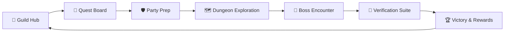

<div align="center">

# ⚔️ RAID
### **Role-based AI Development**
*Turn Coding Tasks into Epic Quests.*

[](https://tauri.app/)
[](https://www.rust-lang.org/)
[](https://react.dev/)
[](https://www.typescriptlang.org/)
[](https://pixijs.com/)
[](https://sqlite.org/)
[](LICENSE)

<br/>

**RAID** is an open-source desktop environment that transforms AI-assisted software engineering into an interactive RPG dungeon-crawler experience. 

Manage AI coding agents as party members in a fantasy realm where real software tasks become quests, repository investigation becomes dungeon exploration, implementation becomes combat, and rigorous verification determines whether the boss has actually fallen.

</div>

---

> 💡 **Core Principle: The party may look like heroes, but every victory must be earned by real work.**  
> RAID is *not* a simulation or a decorative clicker game. Every slash of a sword, drop of boss HP, and quest cleared is directly driven by real Git changes, tool executions, passing test suites, and verified builds.

---

## 🌟 Why RAID?

Developers orchestrating autonomous AI coding agents often drown in messy terminal windows, runaway token usage, invisible background tasks, and unverified code changes.

| Traditional AI Orchestrators | ⚔️ RAID Experience |
| :--- | :--- |
| Endless scrolling terminal walls | **Interactive 2D Guild Hub** with animated party members |
| Vague loading spinners & unknown progress | **Boss HP & Dungeon States** tied strictly to verifiable task milestones |
| Dirty working tree conflicts with local edits | **Automatic Git Worktree Isolation** (`.raid/worktrees/quest_<id>`) |
| Unguarded destructive terminal commands | **Guardian Approval Gate** with interactive prompt authorization |
| "Agent says it works" (hallucinated victory) | **Evidence-Based Completion** (Build + Tests + Lint must exit code 0) |

---

## 🎮 The Gameplay Loop



### 1. 🏰 Guild Hub & 2D World
A persistent, high-performance 2D world rendered with **PixiJS 8**. Watch your party members stand watch, explore, or rest in the Guild Hall. Their speech bubbles and animations react in real-time to streaming agent events.

### 2. 📜 Quest Board & Boss Health System
Post development quests (Features, Refactors, Bug Fixes) with discrete objectives and assign an encounter Boss (e.g., *The Auth Hydra*, *Build Titan*, *Refactor Behemoth*).
* **70% of Boss HP** is divided across completed subtask milestones.
* **30% of Boss HP** is locked behind the verification suite (Build, Test, Lint).
* The Boss is **only defeated** when code is written AND all test checks pass.

### 3. 🛡️ Adventurer Party & Classes
Assign specialized party members to tasks:
* **Warrior (Tank):** Direct, heavy implementation tasks.
* **Mage (DPS):** Analytical investigation, logic, and deep refactoring.
* **Rogue (Scout):** Fast repository recon, issue discovery, and search.
*(Note: Class is visual & organizational identity — it enhances ergonomics without artificially restricting AI model capabilities).*

### 4. 🌳 Zero-Risk Git Worktree Isolation
Never worry about an agent corrupting your active working branch. RAID automatically creates an isolated Git worktree under `.raid/worktrees/quest_<id>` on a separate branch (`raid/quest-<id>`). You can inspect visual diffs cleanly before merging or discard failed experiments in one click.

### 5. ⚠️ Guardian Approval Gates
Whenever an agent attempts a sensitive shell command or file deletion, the battle halts and the **Guardian Approval Modal** requests your royal consent (`y` / `n`) before the agent can proceed.

---

## 🏗️ Technical Architecture

RAID is crafted as a lightweight, memory-efficient native desktop application using modern Rust and React.

```
┌─────────────────────────────────────────────────────────────┐
│                    RAID Desktop (Tauri 2)                   │
├──────────────────────────────┬──────────────────────────────┤
│    Frontend (React + Vite)   │     Backend (Rust + Tokio)   │
│                              │                              │
│  • PixiJS 8 2D World Canvas  │  • Pseudo-Terminal (PTY)     │
│  • Quest Board & Boss HP     │  • Event Normalization Bus   │
│  • Real-time Combat Log      │  • Git Worktree Manager      │
│  • Guardian Approval UI      │  • SQLite Persistence (SQLx) │
│  • Glassmorphic Dark Design  │  • Verification Engine       │
└──────────────┬───────────────┴──────────────┬───────────────┘
               │                              │
               ▼                              ▼
      [Tauri IPC Bridge]             [Subprocess / PTY]
                                              │
                                              ▼
                                       Claude Code CLI
                                              │
                                              ▼
                                 [Isolated Git Worktree]
```

* **Desktop Shell:** [Tauri 2](https://tauri.app/) (Small binary, native OS webview, minimal RAM footprint).
* **Core Backend:** Rust with [Tokio](https://tokio.rs/) async runtime.
* **PTY Process Management:** `portable-pty` for non-blocking bi-directional communication with AI CLI tools.
* **Database:** Local SQLite managed via [SQLx](https://github.com/launchbadge/sqlx) with versioned migrations.
* **Renderer:** [PixiJS 8](https://pixijs.com/) for fluid 60+ FPS 2D canvas graphics and camera controls.
* **Agent Adapter:** Modular `AgentProvider` trait (currently featuring the **Claude Code Adapter**).

---

## 🚀 Quick Start

### Prerequisites

Ensure you have the following installed on your machine:
* **Node.js** (v18 or higher) & **npm**
* **Rust** (v1.85+ with `cargo`) — [rustup.rs](https://rustup.rs/)
* **Git** (v2.20+ for worktree support)
* **Claude Code CLI** installed and authenticated:
  ```bash
  npm install -g @anthropic-ai/claude-code
  claude login
  ```

### Installation

1. **Clone the repository:**
   ```bash
   git clone https://github.com/your-username/raid.git
   cd RAID
   ```

2. **Install frontend dependencies:**
   ```bash
   npm install
   ```

3. **Run in development mode:**
   ```bash
   npm run tauri dev
   ```

Tauri will compile the Rust backend, start the Vite development server, and launch the native desktop application.

---

## 📁 Repository Structure

```text
RAID/
├── src/                  # React + TypeScript Frontend
│   ├── components/
│   │   ├── WorldView.tsx     # PixiJS 8 2D Guild Hub canvas
│   │   ├── QuestBoard.tsx    # Quests, Boss HP, & task objectives
│   │   ├── PartyPanel.tsx    # Adventurer party roster
│   │   ├── ActivityLog.tsx   # Real-time combat & terminal log
│   │   └── ApprovalModal.tsx # Guardian approval prompt
│   ├── types/                # TypeScript interface definitions
│   ├── index.css             # Glassmorphic RPG design tokens
│   └── App.tsx               # Main application orchestration
├── src-tauri/            # Rust Desktop Backend
│   ├── migrations/           # Versioned SQLite schemas
│   ├── src/
│   │   ├── db.rs             # SQLite connection & migration runner
│   │   ├── git.rs            # Git worktree manager
│   │   ├── models.rs         # Database entities & structs
│   │   ├── events.rs         # Normalized event pipeline & states
│   │   ├── commands.rs       # Tauri IPC commands
│   │   ├── providers/        # AI Agent Adapters (Claude Code PTY)
│   │   └── lib.rs            # Application entrypoint & state
│   ├── Cargo.toml            # Rust dependencies
│   └── tauri.conf.json       # Tauri window & bundle config
└── package.json
```

---

## 🗺️ Roadmap

- [x] **Phase 1: Foundation** — Tauri 2 shell, SQLite persistence, Git worktree service, PTY subprocess integration.
- [x] **Phase 2: World Prototype** — PixiJS 8 2D Guild Hub, animated party characters, reactive speech bubbles.
- [x] **Phase 3: Agent Normalization** — Live Claude Code event streaming (`Exploring`, `Fighting`, `NeedsApproval`).
- [ ] **Phase 4: In-App Git Diff Viewer** — Visual side-by-side file inspection before merging worktree branches.
- [ ] **Phase 5: Dungeon & Arena Scenes** — Additional visual biomes (The Bug Crypts, Refactor Citadel).
- [ ] **Phase 6: Multi-Provider Expansion** — Plug-in support for Aider, OpenCode, and local Ollama models.
- [ ] **Phase 7: Sound Effects & Chiptune Audio** — Optional retro 8-bit battle and quest completion audio.

---

## 🤝 Contributing

Contributions are warmly welcome! Whether you are a Rust wizard, a React/PixiJS artist, or a game designer wanting to craft custom dungeon assets:

1. Fork the repository.
2. Create your feature branch (`git checkout -b feature/epic-boss`).
3. Commit your changes (`git commit -m 'feat: Add legendary database migration boss'`).
4. Push to the branch (`git push origin feature/epic-boss`).
5. Open a Pull Request.

---

## 📜 License

This project is licensed under the [MIT License](LICENSE).
